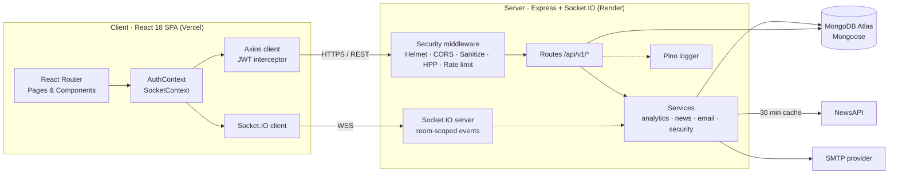
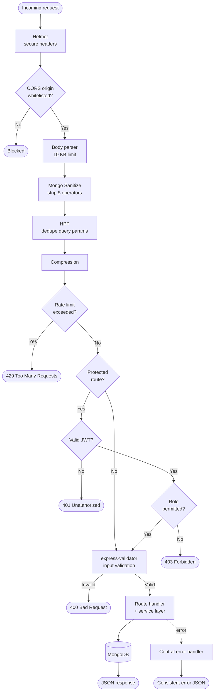
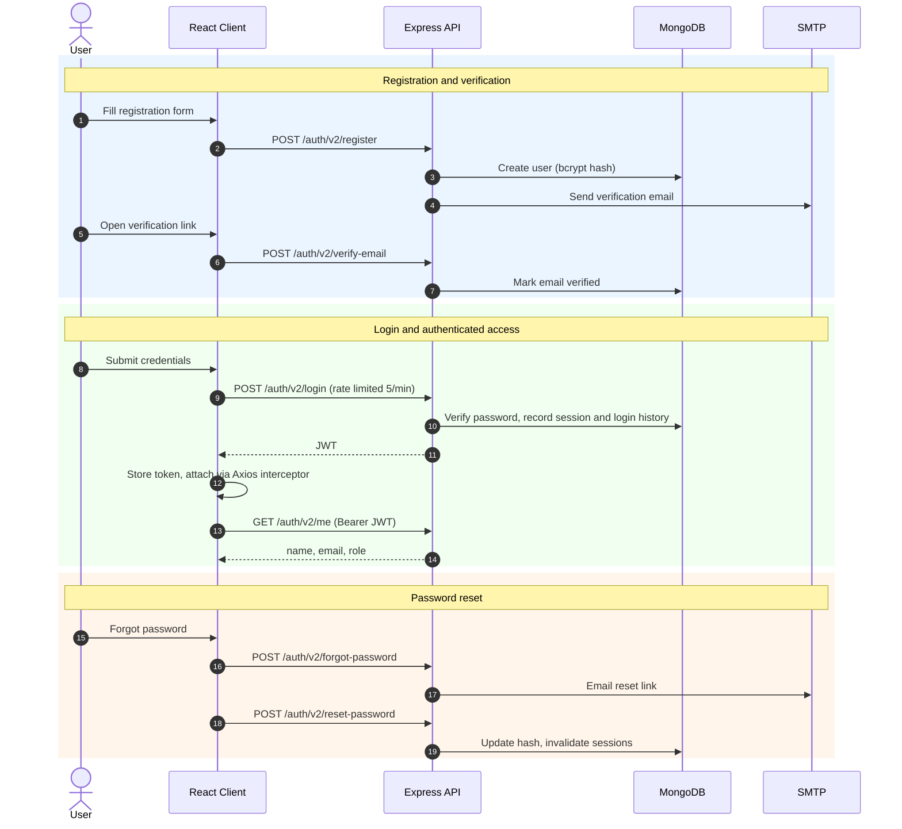
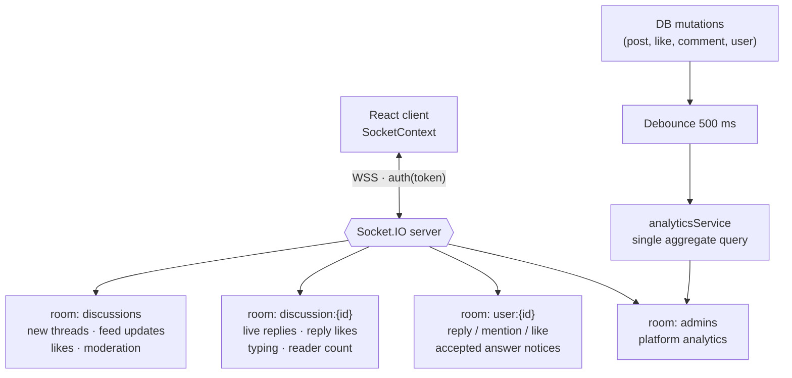
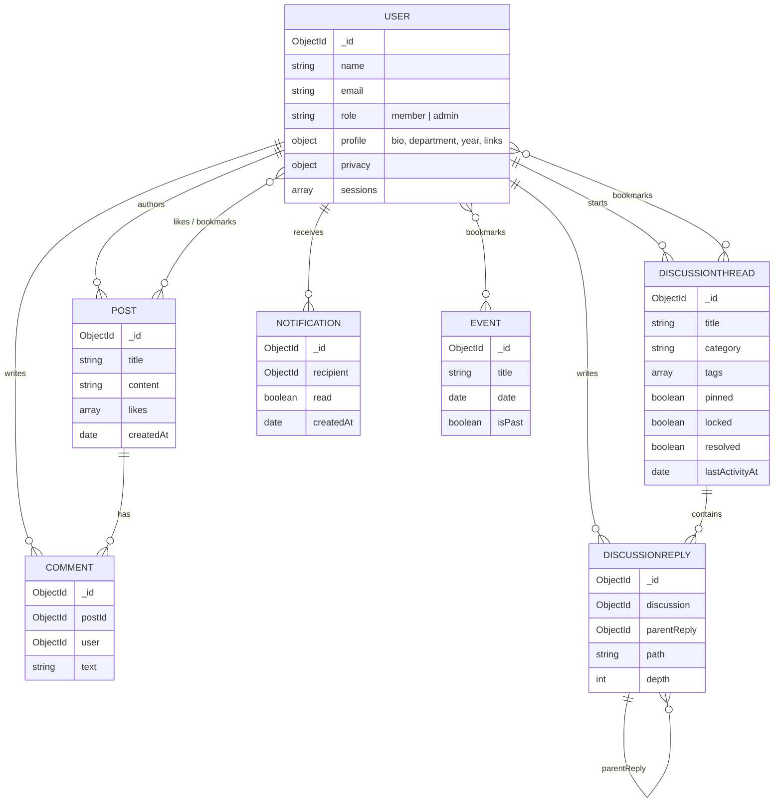
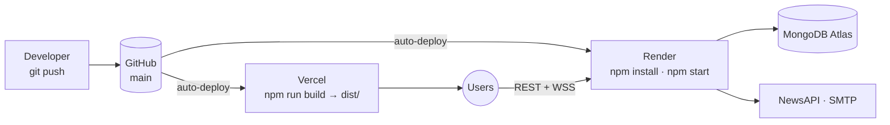

# ACM-XIM-ENVOY

A full-stack community platform for the **ACM Student Chapter at XIM University**: chapter news, events, a real-time Community Hub, profiles, and admin tooling. It is hardened with standard security middleware and tuned for 100+ concurrent users.

**Live:** [Frontend](https://acmmedia-frontend.vercel.app) · [Backend API](https://acmmedia-backend.onrender.com) · [API Docs (Swagger)](https://acmmedia-backend.onrender.com/api-docs)


---

## Table of Contents

- [Features](#features)
- [System Architecture](#system-architecture)
- [Request Lifecycle](#request-lifecycle)
- [Authentication Flow](#authentication-flow)
- [Real-Time Architecture](#real-time-architecture)
- [Data Model](#data-model)
- [Role-Based Access Control](#role-based-access-control)
- [Tech Stack](#tech-stack)
- [Project Structure](#project-structure)
- [Getting Started](#getting-started)
- [Environment Variables](#environment-variables)
- [API Reference](#api-reference)
- [Security](#security)
- [Performance & Scalability](#performance--scalability)
- [Deployment](#deployment)
- [Error Handling](#error-handling)
- [Roadmap](#roadmap)
- [License](#license)

---

## Features

| Audience | Capabilities |
|----------|--------------|
| **Public** | News feed with likes/comments · Tech news (cached, with fallback) · Events · Community Hub (read) · Responsive, mobile-first UI |
| **Members** | Like and comment on posts · Create discussions · Threaded replies with mentions · Upvotes · Bookmarks (posts, discussions, events, articles) · Profile, avatar and banner · Privacy and notification settings · Session management and security logs |
| **Admins** | Create and delete posts and events · Moderate discussions (pin, lock, announce, mark official answer, remove replies) · Live analytics · Image uploads · Create other admin accounts |

---

## System Architecture



---

## Request Lifecycle

Every API request passes through the middleware stack in this order before reaching business logic.



---

## Authentication Flow

Auth V2 adds email verification, password reset, and tracked sessions on top of the original JWT login.



- Passwords are hashed with bcrypt (rounds set via `BCRYPT_ROUNDS`).
- JWTs carry the user ID and role. The server fails fast if `JWT_SECRET` is unset.
- Sessions can be listed and revoked individually (`/sessions`) or all at once (`/logout-all`).
- Admin accounts are provisioned only through the admin-only `POST /auth/create-admin` endpoint.
- The legacy `/auth/*` routes remain mounted for backward compatibility.

---

## Real-Time Architecture



| Room | Who joins | Events |
|------|-----------|--------|
| `discussions` | Anyone on the Community Hub feed | New discussions, feed updates, discussion likes, moderation changes |
| `discussion:{id}` | Only the discussion currently open | Live replies, reply likes, typing indicators, active reader counts |
| `user:{id}` | The authenticated user | Notifications for replies, mentions, likes, accepted answers, announcements |
| `admins` | Admin users | `platform:analytics:update` |

Clients join only the room for the discussion they have open, which keeps socket traffic low. Rapid mutations such as a bulk delete trigger one analytics query, not N.

---

## Data Model



> The diagram shows the relationships and key fields. See [acmmedia-backend/src/models/](acmmedia-backend/src/models/) for the full schemas.

Replies live in their own `DiscussionReply` collection instead of being embedded. `parentReply`, `path`, and `depth` encode the thread tree, so rendering needs no recursive queries and hot threads cannot outgrow MongoDB's document size limit.

**Indexes**

| Collection | Indexes |
|------------|---------|
| User | `{ role, createdAt }` |
| Post | `{ createdAt }`, `{ likes }` |
| Comment | `{ postId, createdAt }`, `{ user }` |
| Event | `{ date }`, `{ isPast, date }` |
| DiscussionThread | text (`title`, `content`, `tags`) · `{ pinned, lastActivityAt }` · `{ category, lastActivityAt }` · `{ status, replyCount, lastActivityAt }` |
| DiscussionReply | `{ discussion, createdAt }`, `{ discussion, parentReply, createdAt }` |
| Notification | `{ recipient, read, createdAt }` |

---

## Role-Based Access Control

| Action | Guest | Member | Admin |
|--------|:-----:|:------:|:-----:|
| View posts, events, discussions | ✅ | ✅ | ✅ |
| Like and comment on posts | ❌ | ✅ | ✅ |
| Create discussions and reply | ❌ | ✅ | ✅ |
| Bookmarks, profile, avatar, password | ❌ | ✅ | ✅ |
| Create posts and events | ❌ | ❌ | ✅ |
| Moderate or delete content | ❌ | ❌ | ✅ |
| View analytics | ❌ | ❌ | ✅ |
| Upload files | ❌ | ❌ | ✅ |
| Create admin accounts | ❌ | ❌ | ✅ |

---

## Tech Stack

| Layer | Technology |
|-------|-----------|
| **Frontend** | React 18, Vite 4, React Router 6, Axios, Socket.IO Client |
| **State** | React Context (Auth, Socket) |
| **Backend** | Node.js 18+, Express 4 |
| **Database** | MongoDB Atlas, Mongoose 7 |
| **Real-time** | Socket.IO 4 |
| **Auth** | JWT, bcryptjs |
| **Security** | Helmet, CORS whitelist, express-mongo-sanitize, HPP, express-rate-limit |
| **Validation** | express-validator |
| **Uploads** | Multer |
| **Caching** | node-cache |
| **Logging** | Pino (pino-pretty in dev) |
| **API Docs** | swagger-jsdoc, swagger-ui-express |
| **External** | NewsAPI, SMTP (Nodemailer-compatible provider) |
| **Hosting** | Vercel (frontend), Render (backend) |

---

## Project Structure

```text
ACM-XIM-ENVOY/
├── acmmedia-backend/              # Express REST API + Socket.IO
│   ├── server.js                  # Entry point
│   ├── vercel.json
│   └── src/
│       ├── config/                # Database, JWT, CORS origins, indexes
│       ├── constants/             # Enums and shared values
│       ├── docs/                  # Swagger / OpenAPI spec
│       ├── middlewares/           # auth, role, security, validators, rateLimiter, errorHandler
│       ├── models/                # User, Post, Comment, Event, DiscussionThread, DiscussionReply, Notification
│       ├── routes/                # auth, authV2, profile, profileV2, posts, comments, forum, events, admin, news, upload
│       ├── services/              # analytics, news, email, security
│       ├── socket.js              # Socket.IO setup and room logic
│       └── utils/                 # logger, pagination, response helpers
│
├── acmmedia-frontend/             # React + Vite SPA
│   ├── vercel.json                # SPA rewrites
│   └── src/
│       ├── api/                   # Axios modules per resource
│       ├── components/            # Navbar, PostCard, CommentBox, TechPulse, Toast, ...
│       ├── constants/
│       ├── context/               # AuthContext, SocketContext
│       ├── hooks/                 # useSocket, useConnectionStatus
│       ├── pages/                 # Home, News, Events, Forum, Profile, Admin, Login, ...
│       ├── styles/
│       └── utils/
│
├── .gitignore
└── README.md
```

**Frontend routes:** `/` · `/login` · `/register` · `/forum` (alias `/discussions`) · `/events` · `/news` · `/profile` · `/profile/:username` · `/security` · `/admin` · `/admin-login`

---

## Getting Started

### Prerequisites

- Node.js 18 or later
- npm
- A MongoDB instance (local or Atlas)

### 1. Clone

```bash
git clone https://github.com/<your-org>/ACM-XIM-ENVOY.git
cd ACM-XIM-ENVOY
```

### 2. Backend

```bash
cd acmmedia-backend
npm install
cp .env.example .env      # then set MONGO_URI and JWT_SECRET
npm run dev
```

The API runs at `http://localhost:5000` and the docs at `http://localhost:5000/api-docs`.

### 3. Frontend

```bash
cd acmmedia-frontend
npm install
cp .env.example .env      # point VITE_* at your backend if not using the default
npm run dev
```

The app runs at `http://localhost:5173`.

### Scripts

| Package | Script | Description |
|---------|--------|-------------|
| backend | `npm run dev` | Start with nodemon |
| backend | `npm start` | Start with node (production) |
| frontend | `npm run dev` | Vite dev server |
| frontend | `npm run build` | Production build to `dist/` |
| frontend | `npm run preview` | Preview the production build |

---

## Environment Variables

### Backend (`acmmedia-backend/.env`)

| Variable | Required | Default | Description |
|----------|:--------:|---------|-------------|
| `MONGO_URI` | ✅ | n/a | MongoDB connection string |
| `JWT_SECRET` | ✅ | n/a | JWT signing secret. The server fails fast if unset. Generate with `openssl rand -hex 32` |
| `NEWS_API_KEY` | | n/a | [NewsAPI](https://newsapi.org) key for tech news |
| `PORT` | | `5000` | Server port |
| `NODE_ENV` | | `development` | `development` or `production` |
| `LOG_LEVEL` | | `info` | `fatal` · `error` · `warn` · `info` · `debug` · `trace` |
| `BCRYPT_ROUNDS` | | library default | bcrypt cost factor |
| `SMTP_HOST` / `SMTP_PORT` / `SMTP_SECURE` | | n/a | SMTP server for verification and reset emails |
| `SMTP_USER` / `SMTP_PASS` | | n/a | SMTP credentials |
| `FROM_EMAIL` | | n/a | Sender address |
| `APP_NAME` / `APP_URL` | | n/a | Used in email content and links |

> Never commit `.env`. Only `.env.example` is tracked.

### Frontend (`acmmedia-frontend/.env`)

| Variable | Required | Default | Description |
|----------|:--------:|---------|-------------|
| `VITE_API_BASE_URL` | | auto-detected | Backend REST base URL (including `/api/v1`) |
| `VITE_SOCKET_URL` | | auto-detected | Socket.IO server URL |

---

## API Reference

All endpoints are prefixed with `/api/v1`. List endpoints accept `?page=1&limit=20` (default 20, max 50). Full interactive docs are available at [`/api-docs`](https://acmmedia-backend.onrender.com/api-docs).

<details>
<summary><strong>Authentication</strong> (<code>/auth/v2</code>)</summary>

| Method | Endpoint | Auth | Description |
|--------|----------|:----:|-------------|
| POST | `/auth/v2/register` | n/a | Register (3/min) |
| POST | `/auth/v2/verify-email` | n/a | Verify email token |
| POST | `/auth/v2/resend-verification` | n/a | Resend verification email |
| POST | `/auth/v2/login` | n/a | Login, receive JWT (5/min) |
| POST | `/auth/v2/forgot-password` | n/a | Request reset email |
| POST | `/auth/v2/reset-password` | n/a | Reset with token |
| GET | `/auth/v2/me` | Bearer | Current user |
| POST | `/auth/v2/logout` | Bearer | End current session |
| POST | `/auth/v2/logout-all` | Bearer | End all sessions |
| POST | `/auth/v2/change-password` | Bearer | Change password |
| GET | `/auth/v2/sessions` | Bearer | List active sessions |
| DELETE | `/auth/v2/sessions/:sessionId` | Bearer | Revoke a session |
| GET | `/auth/v2/login-history` | Bearer | Login history |
| GET | `/auth/v2/security-logs` | Bearer | Security event log |

Legacy `/auth/register`, `/auth/login`, `/auth/me` and admin-only `POST /auth/create-admin` are also available.

</details>

<details>
<summary><strong>Profile</strong> (<code>/profile/v2</code>)</summary>

| Method | Endpoint | Auth | Description |
|--------|----------|:----:|-------------|
| GET | `/profile/v2` | Bearer | Own profile |
| GET | `/profile/v2/achievements` | Bearer | Achievements |
| GET | `/profile/v2/:username` | n/a | Public profile |
| PATCH | `/profile/v2` | Bearer | Update profile |
| PATCH | `/profile/v2/privacy` | Bearer | Privacy settings |
| PATCH | `/profile/v2/notifications` | Bearer | Notification settings |
| POST / DELETE | `/profile/v2/avatar` | Bearer | Upload or remove avatar |
| POST / DELETE | `/profile/v2/banner` | Bearer | Upload or remove banner |
| GET | `/profile/v2/bookmarks/all` | Bearer | All bookmarks |
| POST / DELETE | `/profile/v2/bookmarks/post/:id` | Bearer | Bookmark a post |
| POST / DELETE | `/profile/v2/bookmarks/discussion/:id` | Bearer | Bookmark a discussion |
| POST / DELETE | `/profile/v2/bookmarks/event/:id` | Bearer | Bookmark an event |
| POST / DELETE | `/profile/v2/bookmarks/article` | Bearer | Bookmark a news article |

</details>

<details>
<summary><strong>Posts, Comments, Events</strong></summary>

| Method | Endpoint | Auth | Description |
|--------|----------|:----:|-------------|
| GET | `/posts` | n/a | List posts |
| GET | `/posts/:id` | n/a | Get a post |
| POST | `/posts` | Admin | Create |
| PATCH | `/posts/:id` | Admin | Update |
| PUT | `/posts/like/:id` | Bearer | Toggle like |
| DELETE | `/posts/:id` | Admin | Delete |
| GET | `/comments/:postId` | n/a | List comments |
| POST | `/comments` | Bearer | Add comment |
| DELETE | `/comments/:id` | Admin | Delete comment |
| GET | `/events` | n/a | List events |
| GET | `/events/:id` | n/a | Get an event |
| POST | `/events` | Admin | Create |
| PATCH | `/events/:id` | Admin | Update |
| DELETE | `/events/:id` | Admin | Delete |

</details>

<details>
<summary><strong>Community Hub</strong> (<code>/discussions</code>, alias <code>/forum</code>)</summary>

| Method | Endpoint | Auth | Description |
|--------|----------|:----:|-------------|
| GET | `/discussions` | n/a | Feed. Query: `search`, `category`, `tag`, `sort` (`Trending`, `Latest`, `Most Active`, `Unanswered`, `Solved`) |
| GET | `/discussions/meta` | n/a | Categories and community stats |
| POST | `/discussions` | Bearer | Create a discussion |
| GET | `/discussions/:id` | n/a | Discussion with threaded replies |
| POST | `/discussions/:id/replies` | Bearer | Reply (top-level or nested) |
| POST | `/discussions/:id/like` | Bearer | Toggle upvote |
| POST | `/discussions/replies/:replyId/like` | Bearer | Toggle reply upvote |
| PATCH | `/discussions/:id/moderation` | Admin | Pin, lock, announce, official answer |
| DELETE | `/discussions/:id` | Admin | Delete discussion |
| DELETE | `/discussions/replies/:replyId` | Admin | Remove reply |

</details>

<details>
<summary><strong>News, Admin, Upload</strong></summary>

| Method | Endpoint | Auth | Description |
|--------|----------|:----:|-------------|
| GET | `/news` (alias `/external-news`) | n/a | Tech news (30 min cache) |
| GET | `/admin/stats` | Admin | Platform analytics |
| POST | `/upload` | Admin | Upload an image (10/hour) |
| GET | `/upload` | Admin | List uploads |

</details>

---

## Security

| Layer | Protection | Mitigates |
|-------|-----------|-----------|
| Helmet | Secure HTTP headers | XSS, clickjacking, MIME sniffing |
| CORS | Origin whitelist | Unauthorized cross-origin access |
| Body limit | 10 KB JSON | Payload DoS |
| Mongo Sanitize | Strips `$` operators | NoSQL injection |
| HPP | Dedupes query params | Parameter pollution |
| Rate limiting | Per-IP throttling | Brute force, spam, DDoS |
| express-validator | Schema validation | Malformed or malicious input |
| JWT + RBAC | Token and role checks | Unauthorized access, privilege escalation |
| Pino redaction | Hides passwords, tokens, auth headers | Secret leakage in logs |

**Rate limits**

| Scope | Limit | Window |
|-------|-------|--------|
| Login (`/auth/login`, `/auth/v2/login`) | 5 | 1 minute |
| Register (`/auth/register`, `/auth/v2/register`) | 3 | 1 minute |
| Upload (`/upload`) | 10 | 1 hour |
| All `/api/*` | 100 | 15 minutes |

---

## Performance & Scalability

| Technique | Effect |
|-----------|--------|
| **Compound indexes** | Index lookups instead of collection scans |
| **Pagination** (`skip/limit`, indexed sort) | Never loads whole collections |
| **`.lean()` reads** | Plain objects instead of Mongoose documents: faster serialization, less memory |
| **gzip compression** | Smaller JSON payloads, helpful on mobile |
| **Debounced analytics** (500 ms) | One aggregate query per burst of mutations |
| **Room-scoped sockets** | Clients receive only relevant events |
| **Socket tuning** | 1 MB max buffer, 2-minute connection-state recovery |
| **NewsAPI caching** | 30 min TTL (5 min after an error), placeholder fallback |
| **Graceful shutdown** | `SIGTERM`/`SIGINT` drain in-flight requests for zero-downtime deploys |

Paginated response shape:

```json
{
  "data": [],
  "pagination": {
    "page": 1,
    "limit": 20,
    "total": 150,
    "totalPages": 8,
    "hasNextPage": true,
    "hasPrevPage": false
  }
}
```

---

## Deployment



| Service | Platform | Build | Start / Output |
|---------|----------|-------|----------------|
| Backend | Render | `npm install` | `npm start` (`server.js`). Health check: `GET /` |
| Frontend | Vercel (Vite) | `npm run build` | Output `dist`, SPA rewrites via `vercel.json` |

Set the backend environment variables in the Render dashboard, and add your frontend's origin to the CORS whitelist ([frontendOrigins.js](acmmedia-backend/src/config/frontendOrigins.js)).

---

## Error Handling

A central handler returns a consistent shape:

```json
{ "success": false, "message": "Human-readable error description" }
```

| Type | Status |
|------|:------:|
| Validation, duplicate key, invalid ObjectId | 400 |
| Invalid or expired token | 401 |
| Insufficient permissions | 403 |
| Resource not found | 404 |
| Rate limited | 429 |
| Unexpected failure | 500 |

---

## Roadmap

- [x] Email verification and password reset (Auth V2)
- [x] Notification system (in-app, via Socket.IO)
- [x] Bookmarks and session management
- [ ] Post image attachments
- [ ] Push notifications
- [ ] Atlas Search for full-text search
- [ ] Cursor-based pagination for infinite scroll
- [ ] Redis caching layer
- [ ] Automated tests (Jest + Supertest)
- [ ] CI/CD with GitHub Actions
- [ ] Dark/light theme toggle

---

## License

[MIT](https://opensource.org/licenses/MIT)

Built by the ACM Student Chapter, XIM University.
